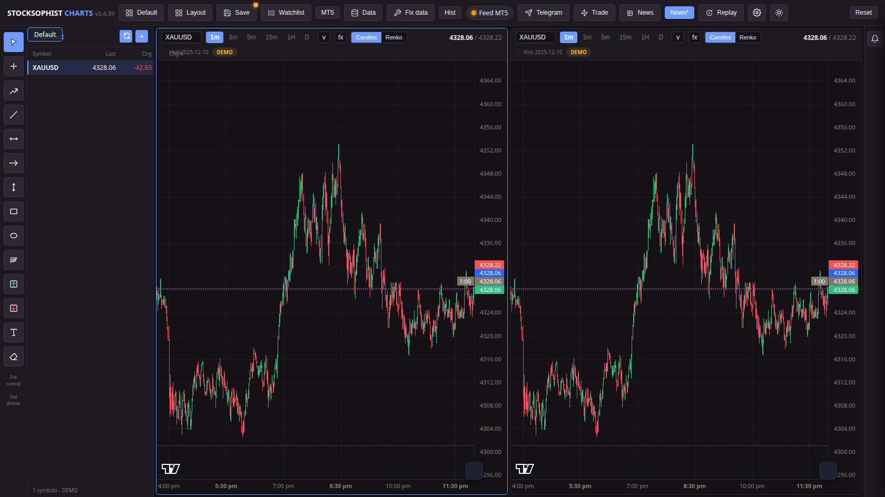
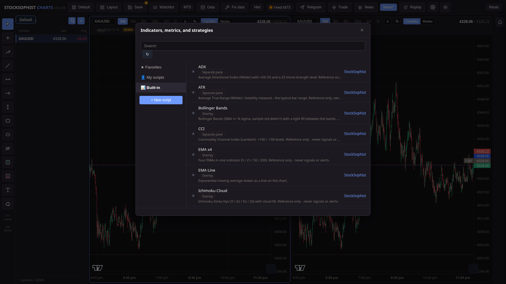
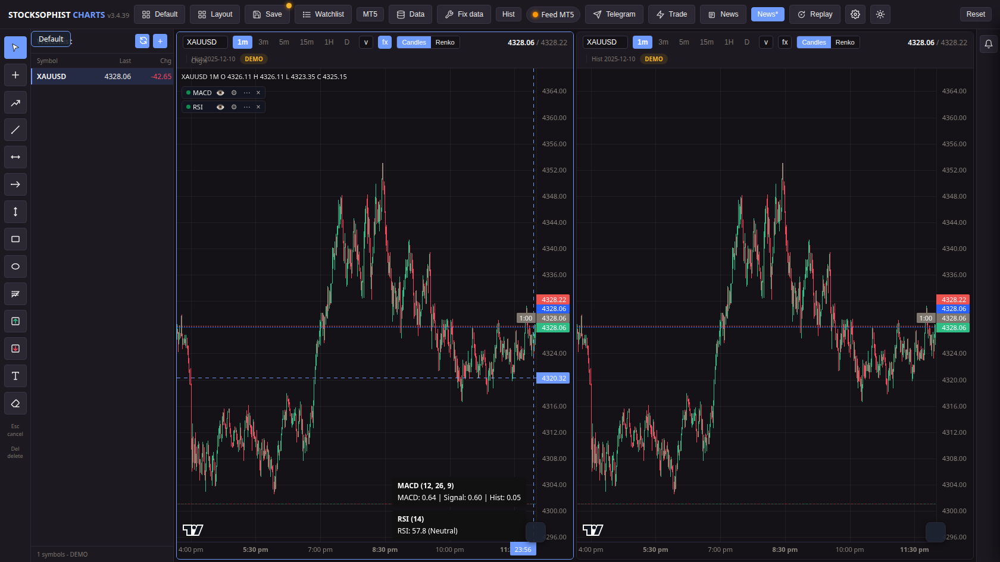
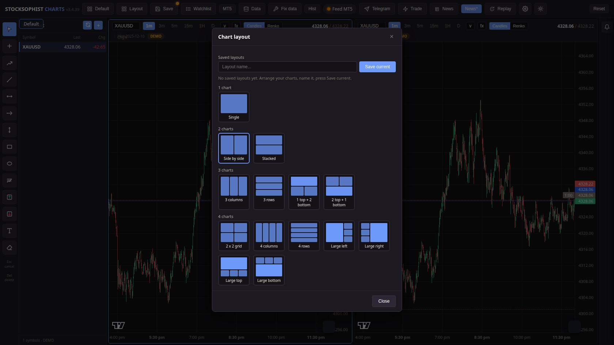
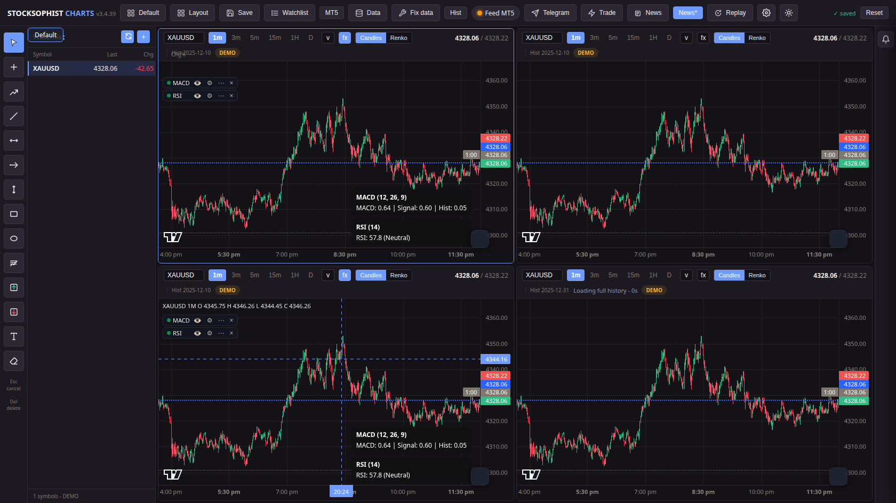
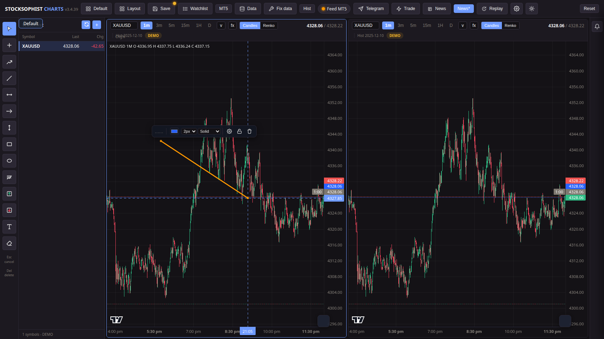
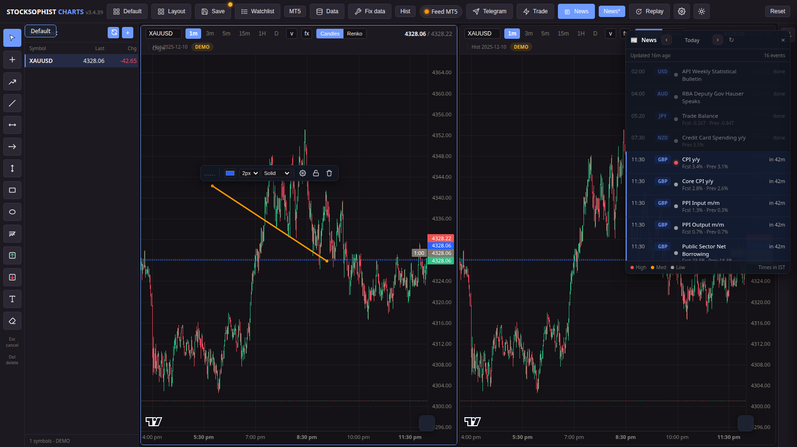
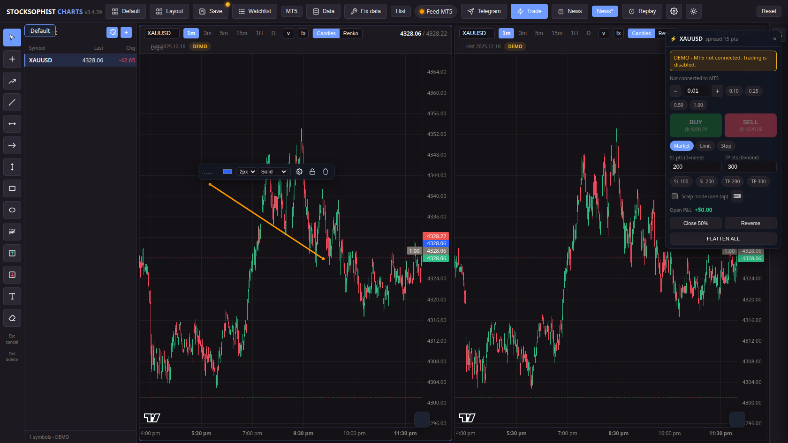

# StockSophist Charts

StockSophist Charts is a local charting application that runs on your own
computer. It draws candlestick charts and Renko bricks, computes standard
technical indicators, keeps a symbol watchlist, and can send chart alerts
to Telegram. Chart data comes from a MetaTrader 5 terminal or from OANDA.

Everything runs locally: the app is a Python/Flask server that serves the
chart UI to your browser. No account with StockSophist is needed and no
chart data leaves your machine except the requests your configured data
feed makes to its own provider (MT5 on your machine, the OANDA API, and
the Telegram API when you enable Telegram alerts).

## What it does

- **Charting** — candlestick charts with 12 timeframes (1s, 15s, 1m, 3m,
  5m, 15m, 30m, 1H, 4H, D, W, M), plus Renko bricks built from the chart's
  own bars. Multiple chart panes side by side, drawings, bar replay, and
  saved layouts (including named layouts).
- **Zoom-sync** — with two or more panes open, press the **Zoom** button
  and drag a box on any chart: every chart zooms to that time range,
  each keeping its own timeframe. Bar replay is synced across panes
  too — start it on any chart and all panes step together.
- **Indicators** — 17 standard textbook indicators (see
  [docs/INDICATORS.md](docs/INDICATORS.md)), each with full Inputs + Style
  settings that persist across restarts. Indicators are reference
  displays: they draw lines, bands, or bars. An indicator by itself does
  not generate signals, and no indicator output is ever used to place
  trades.
- **Watchlist** — add and remove symbols, switch the chart symbol from
  the list. In MT5 mode the list follows the terminal's Market Watch; in
  OANDA mode additions persist in settings.
- **Alerts** — the app's own alert system with price alerts and
  indicator-condition alerts (for example "RSI crosses above 70" or
  "price crosses the EMA"). Each alert is evaluated on candle close, on
  the timeframe it was created for, no matter which timeframe the chart
  currently shows. When an alert triggers you get an on-screen popup and
  a sound (pick a built-in tone or use your own `.wav`), it is written
  to the alert log, and it is delivered to Telegram (if enabled) and/or
  an outbound webhook. Alerts notify you; they do not place trades or
  send orders.
- **Drawing tools** — trend line, horizontal and vertical lines, ray,
  rectangle, Fibonacci retracement, text labels and a measure tool,
  with magnet snapping and per-drawing colour / width / style.
  Drawings are saved with the layout.
- **Data** — live quotes and history from MT5 (Windows) or OANDA; a local
  cache so reopening the app is fast; background jobs that keep history
  complete (gap healing, tick vault, deep-history sync). An economic
  calendar shows news events as display-only markers; news never gates
  signals or alerts.
- **Chart trading (MT5)** — an explicit Trade panel lets you place
  market, limit and stop orders and manage positions through the
  connected MT5 terminal: lot presets, SL / TP in points, a one-tap
  scalp mode, Close 50%, Reverse and Flatten All. Live trading first
  has to be enabled per account inside the panel. Trading is a
  separate, deliberate action: it is never triggered by alerts or
  indicators, and it refuses to run when MT5 is not live.

## Tech stack

- Python 3, Flask (local web server)
- pandas / pyarrow (history handling)
- MetaTrader 5 API (Windows only, for the MT5 data source)
- OANDA v20 REST + streaming APIs (practice environment)
- SQLite (local tick vault, `ticks.db`)
- Lightweight Charts (vendored charting library, runs in the browser)
- pywebview (optional dedicated window on Windows; falls back to the
  system browser)

## Quick start

```sh
git clone https://github.com/stocksophist/stocksophist-charts.git
cd stocksophist-charts
pip install -r requirements.txt
```

On Windows, double-click `start_chart.bat`. On other systems:

```sh
python app/server.py
```

The server starts on `http://127.0.0.1:5000` and opens the chart in your
browser automatically. See [docs/SETUP.md](docs/SETUP.md) for full setup
instructions, including the MT5 connection, OANDA setup, and Telegram
configuration.

## Documentation

- [docs/SETUP.md](docs/SETUP.md) — requirements, install, first run,
  MT5 / OANDA / Telegram setup, uninstall
- [docs/USAGE.md](docs/USAGE.md) — using the chart: top bar, watchlist,
  panes, Renko, drawings, layouts, replay, alerts, chart trading
- [docs/INDICATORS.md](docs/INDICATORS.md) — the 17 indicators, what each
  computes, defaults, and settings
- [docs/FAQ.md](docs/FAQ.md) — troubleshooting
- [docs/ARCHITECTURE.md](docs/ARCHITECTURE.md) — code layout, data flow,
  state files, background jobs
- [docs/API.md](docs/API.md) — HTTP endpoint reference
- [docs/CONFIGURATION.md](docs/CONFIGURATION.md) — every setting:
  `settings.json` keys, environment variables, data directory, Telegram,
  OANDA
- [docs/DEVELOPMENT.md](docs/DEVELOPMENT.md) — tests, adding an
  indicator, comment/style rules, running in dev, making a release
- [DISCLAIMER.md](DISCLAIMER.md) — disclaimer

## Screenshots

All screenshots show the app running in DEMO mode with bundled history
(no broker connected).

**Main chart — candlesticks, watchlist and drawing toolbar**



**Built-in indicators — 17 standard indicators with descriptions**



**Indicators on the chart — MACD and RSI with live values**



**Chart layouts — 1, 2, 3 or 4 charts, named layouts you can save**



**Multi-chart — four panes side by side**



**Drawing tools — trend line with its style toolbar**



**News — economic calendar panel (times in IST, display only)**



**Chart trading — the Trade panel (disabled here because DEMO has no MT5)**



## License

License: see LICENSE

## Disclaimer

StockSophist Charts is provided for education only. It is not trading
advice, and it makes no profit promises. See
[DISCLAIMER.md](DISCLAIMER.md) for the full disclaimer.
